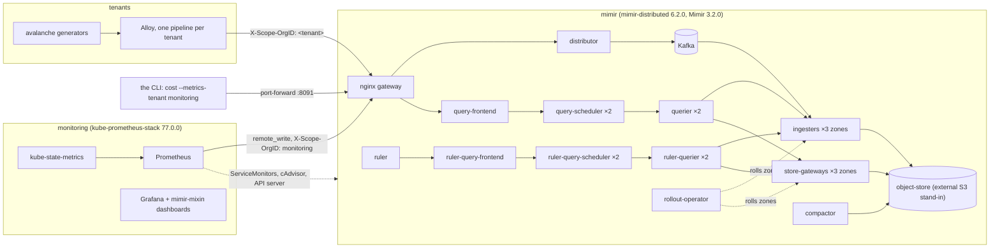

# Staging: production-shaped Mimir on Kubernetes

The environment the v0.1.0 launch is gated on (#51): Grafana Mimir deployed
and monitored **the way an operator runs it in production**, small enough
for one 4-vCPU / 15 GB machine. It is the official `mimir-distributed`
chart at its defaults, with every deviation listed below and justified,
plus kube-prometheus-stack meta-monitoring into a dedicated `monitoring`
tenant, and operational event scripts for the validation lane.

```bash
make cluster              # local k3s-in-Docker cluster (skip on a real cluster)
make deploy               # ingest-storage profile; cluster + deploy measured 7m10s from a cold cache
make cli                  # build the CLI (from PR #50's branch until it merges)
make cost                 # cost report for every tenant: all pools, --rule-outputs, md + json
make down
```

`make deploy` only talks to `KUBECONFIG`, so the same command installs onto
this container's k3s, a laptop k3d or kind cluster, or GKE/EKS:
`KUBECONFIG=~/.kube/gke make deploy`. On a real cluster set
`DOCKERHUB_ONLY=0` to use the charts' own image references.

## What runs



| Namespace | What | From |
|---|---|---|
| `mimir` | Mimir, every component in its own pod: 3 zone-aware ingesters (RF=3), 3 zone-aware store-gateways, 2 queriers, 2 query-schedulers, ruler with the dedicated remote-evaluation read path, alertmanager, compactor, overrides-exporter, rollout-operator, Kafka (ingest profile) | [`values/mimir.yaml`](values/mimir.yaml) |
| `monitoring` | kube-prometheus-stack: Prometheus Operator, Prometheus, Alertmanager, kube-state-metrics, node-exporter, Grafana | [`values/kube-prometheus-stack.yaml`](values/kube-prometheus-stack.yaml) |
| `object-store` | MinIO, standing in for the cloud bucket | [`manifests/object-store.yaml`](manifests/object-store.yaml) |
| `tenants` | **Interim** traffic: `dev/mimir-k8s`'s avalanche tenants (`analytics` ×2 teams, `infra`, `payments`, `platform`), their rules, and an Alloy agent per tenant pipeline. Replaced by the validation lane's `workload/` | [`interim-tenants/`](interim-tenants) |

## Profiles

| `PROFILE=` | Write path | Replication |
|---|---|---|
| `ingest` (default, primary) | Mimir 3.x and the chart's default: distributors write to Kafka, each ingester consumes one partition | 3: the same partition is owned by an ingester in each of the 3 zones |
| `classic` | distributors replicate each series to ingesters over gRPC | 3: `replication_factor` 3 (Mimir's default), one replica per zone |

The two differ only in [`values/profile-classic.yaml`](values/profile-classic.yaml).
Switching a deployed cluster between them is not a supported Mimir
migration, and `make deploy` refuses to do it: `make undeploy` first.

`RULER_EVAL=local` ([`values/ruler-local.yaml`](values/ruler-local.yaml))
puts the ruler back to the chart's default, local evaluation, so the CLI's
evaluation-mode inference can be checked in both directions. Unlike
`PROFILE`, this switches in place: `make mimir RULER_EVAL=local`, about 2
minutes. Under default ruler flags the CLI currently misreads local
evaluation as remote (#65).

### Footprint

Measured on the ingest profile with the interim tenants, 10 minutes after a
cold deploy, on a 4 vCPU / 15.7 GiB node:

| | CPU | Memory |
|---|---:|---:|
| requests (scheduled) | 2.69 cores (67%) | 7.9 GiB (50%) |
| used, whole node (k3s included) | ~1.6 cores | 4.9 GiB |
| used, `mimir` namespace | ~0.4 cores (ingesters 0.14, Kafka 0.03) | 2.25 GiB |
| used, `monitoring` namespace | | 0.85 GiB |

Scaling ingesters to 2 per zone adds 0.3 cores and 1.5 GiB of requests.
`monitoring` is the largest tenant, at ~100k active series (cAdvisor,
kubelet, API server, kube-state-metrics and Mimir itself), against ~21k
for the four interim tenants together. That is realistic: meta-monitoring
is usually one of a cluster's biggest tenants.

## Deviations from chart defaults

These tables are what lets us call this environment production-shaped.
Anything not listed is the chart's own default. That includes ingest storage,
zone-aware replication, the rollout-operator, alertmanager, the
overrides-exporter, the nginx gateway, replica counts, every component's
resource requests except Kafka's CPU, PVC sizes, Kafka's 100 partitions and
Mimir's limits for every tenant except `monitoring`.

### mimir-distributed 6.2.0

| Setting | Chart default | Here | Why |
|---|---|---|---|
| `minio.enabled` + `mimir.structuredConfig.common.storage` | bundled MinIO | external S3 endpoint (`object-store` namespace); credentials from Secret `mimir-bucket` via env (`global.extraEnvFrom`) | Production Mimir writes to a cloud bucket. The chart calls its bundled MinIO a demo convenience, and MinIO no longer publishes its images to Docker Hub |
| `ruler.remoteEvaluationDedicatedQueryPath` | `false` (local evaluation) | `true` | The chart's way of deploying remote rule evaluation, which large production clusters run. It changes which pool rule work lands in (ADR 0003 [V], #50), so staging has to exercise it |
| `kafka.resources.requests.cpu` | `1` | `250m` | A full-core reservation for a broker that uses well under 0.1 core at staging traffic, on a 4-vCPU node. Without this change the scale-up event cannot schedule. Memory stays at the default 1Gi |
| `metaMonitoring.serviceMonitor.enabled`, `.clusterLabel` | off | on, `cluster=staging` | Lets kube-prometheus-stack scrape Mimir with the job and cluster labels the mixin and the CLI expect |
| `metaMonitoring.prometheusRule.{mimirRules,mimirAlerts}` | off | on | The mixin's recording rules and alerts, evaluated by Prometheus. The dashboards need the rules |
| `metaMonitoring.dashboards.enabled` | off | on, in `monitoring` | The mixin dashboards for Grafana's sidecar |
| `runtimeConfig.overrides.monitoring` | none | `max_global_series_per_user: 1000000`, `ingestion_rate: 100000` | Raises limits per tenant, the way an operator would. `monitoring` holds everything kube-prometheus-stack scrapes, which is more than the 150k-series default. Simulated tenants keep the defaults |
| `gateway.nginx.config.enableIPv6` | `true` | `false` | **Environment-forced**: the cloud container's kernel has no IPv6, so nginx fails to bind `[::]:8080`. Drop this override on a dual-stack cluster |

Not changed, deliberately: **memcached caches** stay off, as in the
chart's default. Production values (`small.yaml`) enable them, but they would
not change any driver the CLI reads (`cortex_query_fetched_*` counts bytes
fetched whether or not a cache serves them) and they cost several GB. See
the questions in the PR.

### kube-prometheus-stack 77.0.0

| Setting | Chart default | Here | Why |
|---|---|---|---|
| `crds.enabled` | chart installs CRDs | applied server-side by `scripts/monitoring-crds.sh`, before Mimir | Mimir's ServiceMonitors need them first, and Helm never upgrades CRDs |
| `prometheus.prometheusSpec.*SelectorNilUsesHelmValues` | `true` | `false` | Picks up the Mimir chart's ServiceMonitors and PrometheusRules. This is the usual setting when another chart ships its own monitors |
| `prometheus.prometheusSpec.remoteWrite`, `externalLabels` | none | Mimir gateway, `X-Scope-OrgID: monitoring`; `cluster=staging` | The point of the stack here |
| `prometheus.prometheusSpec.retention` | `10d` | `1d`, on a 5Gi PVC | Mimir is the long-term store |
| `prometheusOperator.admissionWebhooks`, `.tls` | on | off | **Environment-forced**: the webhook's certgen image is only on registry.k8s.io. The webhook only validates PrometheusRule syntax |
| `kubeEtcd`, `kubeScheduler`, `kubeControllerManager`, `kubeProxy` | on | off | k3s embeds these in one process, and managed control planes aren't scrapeable. Their "target down" alerts would fire forever |
| `grafana` anonymous admin, Mimir datasource | login | anonymous, plus a `Mimir (monitoring)` datasource | Reached only through a local port-forward |
| images (`DOCKERHUB_ONLY=1`) | quay.io, registry.k8s.io | Docker Hub copies: `prom/*` from upstream; operator, config-reloader and kube-state-metrics from Rancher's `rancher/mirrored-*`; kube-state-metrics v2.15.0 instead of v2.16.0 | **Environment-forced**, see below. The overrides are in [`values/dockerhub/`](values/dockerhub) so they can be dropped as one file |

### Why kube-prometheus-stack, not the chart's Alloy / Agent path

Mimir's own series go into the `monitoring` tenant through
**kube-prometheus-stack**: the Prometheus Operator discovers the Mimir chart's
ServiceMonitors, and Prometheus remote-writes to Mimir. We picked it because
it is the most common way Kubernetes operators monitor anything. Most
platform teams that run Mimir already have it, and the Mimir chart's
`metaMonitoring.serviceMonitor` / `prometheusRule` exist for exactly this
case. The chart's alternative, `metaMonitoring.grafanaAgent`, needs the Grafana
Agent Operator, which is deprecated. It also gives us kube-state-metrics and
cAdvisor in the same tenant with standard labels, which PR #49's `podcost`
needs (`kube_pod_container_resource_requests`, `container_cpu_usage_seconds_total`,
`container_memory_working_set_bytes`, by namespace and pod).

## Operational events

`make events` lists them. Each event does what an operator would do,
waits until the cluster has settled, and is safe to re-run.

| `make event-…` | Action | What it exercises |
|---|---|---|
| `ingester-rolling-restart` | `kubectl rollout restart` on the 3 zone StatefulSets; the rollout-operator rolls one zone at a time | counter resets, active series repopulating (WAL or Kafka replay) |
| `scale-ingesters ARGS=REPLICAS=2` | scales every ingester zone to N per zone (`noop` if already N) | new ring tokens (classic) or new Kafka partitions (ingest) |
| `querier-restart` | rolls the main-path queriers | `cortex_query_*` resets |
| `ruler-restart` | rolls the ruler | rule-evaluation counter resets, group resharding |
| `store-gateway-restart` | rolls the 3 store-gateway zones | block index re-sync |

Each event appends JSON lines to `$EVENT_LOG` (default `.state/events.jsonl`):

```json
{"ts":"2026-10-21T19:44:11Z","unix":1792611851,"event":"ingester-rolling-restart","phase":"start","profile":"ingest","detail":{"component":"ingester","pods":["pod/mimir-ingester-zone-a-0","pod/mimir-ingester-zone-b-0","pod/mimir-ingester-zone-c-0"]}}
{"ts":"2026-10-21T19:48:26Z","unix":1792612106,"event":"ingester-rolling-restart","phase":"end","profile":"ingest","detail":{"component":"ingester"}}
```

`phase` is `start`, `end`, `noop` (already in the requested state, so no
start/end) or `failed`.

Scale-up only: the chart labels every ingester zone
`grafana.com/min-time-between-zones-downscale=12h`, so the rollout-operator's
webhook refuses a second zone's downscale for 12 hours, as it would in
production. The script refuses downscales up front, and `make undeploy deploy`
resets.

**Right after an ingester (re)start**, it reports
`cortex_ingester_active_series_loading` for a few minutes, and its
`cortex_ingester_active_series` is absent or partial. A window that covers
it reads low.

**Watch out after `scale-ingesters` under ingest storage.** Series that now
hash to the new partition stay active in the old one until the idle timeout
(~20m). For that long, an instant `sum` of `cortex_ingester_active_series`
counts them twice. The CLI's window average moves only gradually, so compare
against ground truth only after the old copies age out.

## Using it

| Target | |
|---|---|
| `make status` | pods, profile, per-tenant active series as Mimir counts them |
| `make forward` | background port-forwards, restarted if their pod moves: Mimir on `127.0.0.1:8091`, Grafana on `127.0.0.1:3091` (`MIMIR_PORT`, `GRAFANA_PORT`) |
| `make promcost-config` | writes `.state/promcost.yaml`: the forwarded backend, plus an inventory whose replica counts are **read from the cluster**. Prices are illustrative. Re-run it after scaling |
| `make cli` | builds `bin/$(CLI_NAME)` from `CLI_REF` (default `origin/pools-6-7-cost`) in a throwaway worktree |
| `make cost` (`SINCE=1h`, `TENANTS=a,b`) | `cost --metrics-tenant monitoring`, all pools, `--rule-outputs`, md to stdout, md + json saved under `.state/cost/` |
| `make undeploy` | removes every release and namespace (data included) and keeps the cluster |

The product name lives in one variable: `CLI_NAME` in the Makefile.

## Running in the cloud container

The cloud container breaks a few assumptions that hold on a laptop. Each
workaround below is scripted and only applies where it is needed:

| Problem | Symptom | Workaround |
|---|---|---|
| Docker daemon not running | `Cannot connect to the Docker daemon` | `dockerd > /tmp/dockerd.log 2>&1 &` (by hand, before `make cluster`) |
| k3d's tools image is on ghcr.io (denied) | k3d hangs | `cluster/up.sh` runs plain k3s in a container |
| containerd in the node can't pull: it doesn't trust the egress proxy's CA, and Docker Hub rate-limits (429) | `ImagePullBackOff`, `x509: unknown authority` | `cluster/load-images.sh` renders every release with the exact deploy arguments, pulls each image on the host through `mirror.gcr.io` (falling back to docker.io), and imports it into the node's containerd |
| quay.io, registry.k8s.io, ghcr.io denied | image pulls fail | Docker Hub copies (`values/dockerhub/`). The bundled MinIO is replaced by Bitnami's |
| `CAP_SYS_RESOURCE` dropped, so nothing can lower `oom_score_adj` | every pod: `runc create failed: can't get final child's PID from pipe: EOF` | `cluster/up.sh` sets containerd's `restrict_oom_score_adj` (made for rootless setups) |
| Disk reports 252 GB, but the allowance is ~30 GB | kubelet image GC deletes the preloaded pause image, and pods die after a restart | absolute kubelet thresholds: `image-gc-high-threshold=100`, `eviction-hard=…<2Gi` |
| `/` is not a shared mount | node-exporter: `path "/" is mounted on "/" but it is not a shared or slave mount` | `mount --make-rshared /` in the node's entrypoint, as k3d does |
| No IPv6 | gateway: `socket() [::]:8080 failed (97)` | `gateway.nginx.config.enableIPv6: false` |
| get.helm.sh and grafana.github.io denied | no helm, no `helm repo add` | `scripts/tools.sh` builds helm with `go install`. Charts come from their GitHub release assets |
| The container is ephemeral | everything is lost | commit and push. `make cluster deploy` rebuilds from scratch |

## For the validation lane

- `KUBECONFIG=dev/staging/.state/kubeconfig`, Mimir at `http://127.0.0.1:8091`
  after `make forward`. Inside the cluster, use `http://mimir-gateway.mimir.svc`.
- Mimir's own metrics, cAdvisor and kube-state-metrics are in tenant
  `monitoring` (`cluster="staging"`, `job="mimir/<component>"`).
- Interim tenants are in namespace `tenants`. `make deploy INTERIM_TENANTS=0`
  leaves them out for a loadgen run (`workload/`, namespace `loadgen`), and
  `make cost TENANTS=steady,cardinal,…` names the tenants to cost.
- Events: `make -C dev/staging event-<name>`. `make events-json` writes
  `.state/events.json` in `validate.py --events` format (`[{name, start, end, …}]`).
