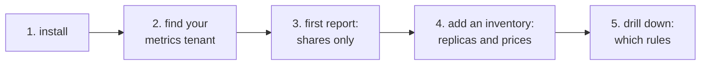

# Getting started

This guide takes you from nothing to a first `promcost cost` report, then to a priced one. Expect about 15 minutes if Mimir already scrapes its own metrics. If it doesn't, set that up first ([Prerequisites](prerequisites.md)).



## 1. Install

<!-- TODO(launch/release): replace with the release lane's snippet. -->

> **Placeholder:** release binaries and the container image arrive with v0.1.0. Until then, build from source:

```sh
go install github.com/KorhanOzturk90/obscost/cmd/promcost@latest   # needs Go 1.27+
promcost --help
```

## 2. Find the tenant that holds Mimir's own metrics

promcost doesn't scrape anything. It asks Mimir's query API about Mimir's own metrics (`cortex_ingester_active_series`, `cortex_query_fetched_chunk_bytes_total` and so on). Those metrics live in whichever tenant your meta-monitoring writes them into, often called `monitoring`, `meta` or `infra`. That tenant is your `--metrics-tenant`.

To check, run this as that tenant. It should list your real tenants:

```sh
curl -s -H 'X-Scope-OrgID: meta' \
  'http://<mimir>/prometheus/api/v1/query' \
  --data-urlencode 'query=count by (user) (cortex_ingester_active_series)'
```

If the result is empty, you're asking the wrong tenant, or nothing scrapes the ingesters. See [Prerequisites → meta-monitoring](prerequisites.md#mimirs-own-metrics-and-the-metrics-tenant).

## 3. A first report, with shares only

Start from the [example config](../examples/promcost.yaml), or use this minimal one:

```yaml
# promcost.yaml
backend:
  url: http://mimir-gateway.mimir.svc:8080   # base URL; promcost adds /prometheus/api/v1/query
```

```sh
promcost cost --config promcost.yaml --metrics-tenant meta --since 24h
```

With no inventory, each pool is split into shares only. For each pool, the report shows:

- a **headline** naming the biggest tenant and its share
- a **table** with every tenant, never a top N. Tenants are sorted by share, and shares sum to 100%.
- **Read before quoting**: the caveats for this particular run
- an **Assumptions** table: the exact PromQL, the replication factor and its source, and every inventory value used

The run ends with a "Cost across pools" section. Without prices it says there's no cross-pool total, and why.

Add `--tenant a,b,c` with the tenants you expect. Any of them that Mimir didn't measure then shows up as `not measured`, instead of being missing from the table.

## 4. Add an inventory: replica counts, then prices

Add what you know. Each value you supply unlocks one more column, and nothing is guessed for the values you leave out.

```yaml
inventory:
  currency: EUR
  pools:
    ingester_memory:
      replicas: 8                  # "≈ ingesters" column
      cost_per_replica_month: 310  # "EUR/month" column
    query_path:
      components:
        query-frontend: {replicas: 2, cost_per_replica_month: 60}
        querier:        {replicas: 6, cost_per_replica_month: 180}
    ruler_cpu:
      replicas: 2                  # replicas only: "≈ rulers", pool not costed
```

This is the output from that inventory (in `examples/promcost.yaml`). It came from running the v0.1 binary against a **stub of Mimir's query API that serves fixed values**, not a real cluster. The values match the fixture in the README, and the output is trimmed to pool 1:

```
## Ingester memory

Average over the last 7d, ending 2026-10-21T16:49:37Z. Pool: 8 ingesters, 2,480.00 EUR/month.

**`analytics` uses 40.9% of ingester memory** — the equivalent of 3.3 of your 8 ingesters, 1,013.93 EUR/month.

| Tenant | Active series | Share | ≈ ingesters | EUR/month |
|---|---:|---:|---:|---:|
| analytics | 15,005 | 40.9% | 3.27 | 1,013.93 |
| monitoring | 12,643 | 34.4% | 2.76 | 854.33 |
| infra | 7,743 | 21.1% | 1.69 | 523.22 |
| payments | 1,205 | 3.3% | 0.26 | 81.43 |
| platform | 105 | 0.3% | 0.02 | 7.10 |
| **Total** | **36,701** | **100%** | **8** | **2,480.00** |

### Assumptions

| Input | Value | Source |
|---|---|---|
| driver | `cortex_ingester_active_series (active series), averaged over 7d` | `Mimir metrics (queried as tenant meta)` |
| driver query | `avg_over_time((sum by (user) (cortex_ingester_active_series unless on (cluster, namespace, job) cortex_partition_ring_partitions))[7d:7m])` | `Mimir metrics (queried as tenant meta)` |
| write path | `classic` | `detected from which driver query returned data` |
| replication factor | `3` | `max(max_over_time(cortex_distributor_replication_factor[7d]))` |
| ingester replicas | `8` | `promcost.yaml inventory` |
| price | `310.00 EUR per ingester-month × 8 = 2480.00 EUR/month` | `promcost.yaml inventory` |
```

Every number traces back to a row in the Assumptions table. If you dispute a figure, change the input and run it again.

The cross-pool section now has a total. Without `inventory.platform_cost_month` it reads "X% of the cost of the priced pools". With it, it reads "X% of the Y% of platform cost we can price". Each key is described in [Configuration](configuration.md).

### Useful flags

| Flag | What it does |
|---|---|
| `--since 7d` | Window to average or total over. Takes Go durations plus `d` and `w`. Default `1h`. |
| `--pool ingester_memory,ruler_cpu` | Read only these pools. Pools left out are listed as "not read in this run". |
| `--format json` | One JSON document on stdout, for `jq` or a spreadsheet. A value that wasn't measured is **absent** from the JSON, never `0`. |
| `--tenant a,b` | Tenants you expect. Any that weren't measured are reported as `not measured`. |
| `--selector '{cluster="prod-eu"}'` | Pick one Mimir cluster when the metrics tenant holds several. promcost warns on stderr when you need it. |

A long `--since` on a big cluster can hit the client timeout. See [Troubleshooting → timeouts](troubleshooting.md#a-query-times-out).

## 5. Drill down: which rules

### Recording rules and the series they write

```sh
promcost cost --config promcost.yaml --metrics-tenant meta \
  --rule-outputs --tenant analytics,payments            # rule definitions from Mimir's ruler API
# or: --rule-outputs --dir ./rules                     # from a local checkout (needs tenancy.discovery)
```

This adds a section per tenant, listing each recording rule, the series its `record:` name has right now, and that count as a share of the tenant's active series. It's a point-in-time count. The report says so, and it says the count is not a breakdown of ingestion. Alerting rules write no series, and the report lists them as such, not as zero-cost. `--rule-outputs` needs `ingester_memory` in `--pool`, and it queries Mimir **as each costed tenant** (see [Permissions](prerequisites.md#permissions-and-headers)).

### Ruler workload per rule group or per rule

`promcost report` is the older, deeper drill-down. It ranks tenants and rule groups by ruler workload:

```sh
# Per rule group, from Mimir's own rule metrics. Needs no log capture.
promcost report --config promcost.yaml --metrics-tenant meta --since 7d

# Per rule, from the ruler's query-stats log (-ruler.query-stats-enabled=true)
promcost report --config promcost.yaml --tenant analytics,payments \
  --telemetry ruler.log --telemetry-format mimirlogs --since 7d
```

To see the report's shape without a Mimir, run it against the checked-in fixture:

```sh
promcost report --dir internal/cli/testdata/report/clean/rules \
  --config internal/cli/testdata/report/clean/promcost.yaml \
  --telemetry internal/cli/testdata/report/clean/executions.ndjson
```

Run `promcost report --help` for all the flags. [ADR 0002](adr/0002-where-workload-evidence-comes-from.md) explains which source answers which question.

## Next

- [How it works](how-it-works.md): what each number means, and what it deliberately doesn't claim
- [Troubleshooting](troubleshooting.md): "not measured", "unknown", empty reports, timeouts and auth
