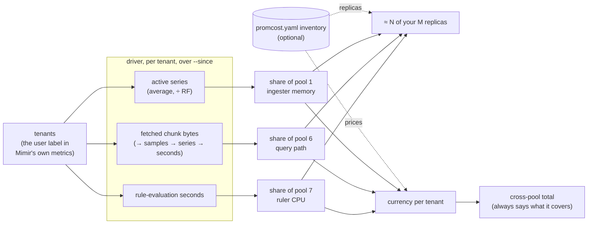
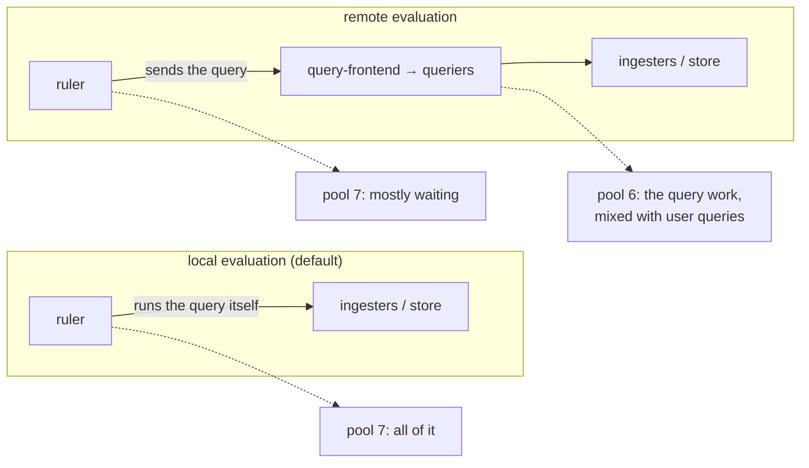

# How it works

**In one sentence:** for each shared Mimir component, promcost measures the per-tenant quantity that physically makes that component grow. It turns those quantities into shares that sum to 100%, and multiplies the shares by a replica count or a price, but only if you supplied one.



## The model

For each pool:

```
share(tenant, pool) = driver(tenant, pool) / Σ driver(every measured tenant, pool)
replicas(tenant)    = share × replicas you supplied
cost(tenant, pool)  = share × replicas × price you supplied
```

| Pool | Component(s) | Driver | Why this driver |
|---|---|---|---|
| 1 | ingesters | `cortex_ingester_active_series`, summed per tenant, averaged over the window, ÷ replication factor | Every active series is held in ingester memory. It's the best-understood dominant cost of Mimir. |
| 6 | query-frontend + queriers | fetched chunk bytes. If that has no data: samples processed, then series fetched, then query seconds | Data volume is what queriers and ingesters actually work through. Wall time also depends on what else is running, so it's the last resort, and the report flags it when it's used. |
| 7 | ruler | `cortex_prometheus_rule_evaluation_duration_seconds_sum` | Rule evaluation time. Under remote evaluation, see [below](#rules-and-the-two-evaluation-modes). |

Pools 2 to 5 (write path, object storage, store-gateway, compactor) are defined in [ADR 0003](adr/0003-cost-model-pool-driver-mappings.md), but they aren't built yet. Every report lists them as "not modelled yet".

**Gauges and counters are read differently.** Active series is a gauge. promcost sums across ingesters *inside* a subquery and averages the sum over the whole window, so an ingester rollout doesn't double-count. A minute where a tenant had no series counts as 0, so a tenant that appears halfway through isn't credited with its full-window level. Minutes where Mimir's own metrics are missing are left out, and the trail says how many points were used. Pools 6 and 7 are counters, read with `increase()` over the window, which handles counter resets. [ADR 0003 "How each driver must be read"](adr/0003-cost-model-pool-driver-mappings.md#a-how-each-driver-must-be-read) has the full reasoning.

## What promcost deliberately doesn't do

### It never fits weights by regression

One alternative is to take a bill and regress it against series, samples and queries to find "what a series costs". promcost doesn't. Those signals move together, so the fitted weights are unstable and can change sign from month to month. A fitted coefficient also can't be explained to the team being charged. "Your share of ingester memory is 62%" can be checked. A bill is useful to **check** the model (do the pools add up to the invoice?), not to fit it. See [ADR 0004, decision 2](adr/0004-finops-pivot-scope-and-sequencing.md#2-allocate-by-pool-and-driver-do-not-fit-weights-by-regression).

### It never spreads unpriced or unmodelled cost across tenants

- **Unpriced pools are "not costed", not zero.** A cross-pool total covers only the priced pools, and says which ones they are: "45.4% of the 31.2% of platform cost we can price". If nothing is priced, there's no total.
- **Unmodelled pools aren't absorbed.** Storage and compactor cost aren't folded into the three modelled pools, and neither is any other cost you didn't price. Use `platform_cost_month` so the headline shows how much is left out.
- **One pool's cost is never split by another pool's driver.** Each pool is divided once, by its own driver.

### What happens to idle capacity: it's allocated by share, in plain sight

A priced pool's **whole** cost, headroom included, is divided by usage share. "≈ N of your M ingesters" adds up to all M, and the currency column adds up to the full pool cost. So a tenant using 40% of the active series carries 40% of the ingesters, including 40% of the spare capacity.

There's no separate idle line in v0.1. This is the usual "fully loaded" allocation, and every input is visible: the share, the replica count and the price.

### It never turns "not measured" into 0

A tenant with no series for a driver is left out of that pool's denominator and shown as `not measured`. Counting it as 0 would understate that tenant and inflate everyone else. When such a tenant appears in a cross-pool total, its total is marked `≥` (a lower bound), and the report notes that the other tenants' figures are inflated by the same amount. See [ADR 0003, decision 5](adr/0003-cost-model-pool-driver-mappings.md#5-a-missing-driver-is-not-measured-never-zero).

### Every figure carries its assumption trail

Each pool section ends with an Assumptions table that lists:

- the driver metric
- the exact PromQL
- the replication factor and where it came from
- the write path and the rule evaluation mode that were detected
- every inventory value used

If someone disputes a number, they can see what it rests on, change that input, and run it again.

## Replication factor and write path

A uniform replication factor cancels out of a share, so **shares are always correct without it**. Absolute active series, and with them "how much memory", aren't. Under the classic write path, promcost divides by `cortex_distributor_replication_factor`, or by `inventory.replication_factor` if you set it. Under ingest storage the query already counts each series once. With no replication factor known, absolute figures are withheld, not guessed. [Prerequisites](prerequisites.md#replication-factor) has the resolution order.

## Rules and the two evaluation modes

A rule is a query that runs on a schedule, so its cost is mostly the cost of **evaluating** it. Where that cost lands depends on the ruler:



promcost infers the mode from which metrics the ruler exports, unless you state it with `inventory.ruler_evaluation`. It records the mode and its evidence in both pools' assumptions, and says "unknown" when there's no evidence either way. Under remote evaluation, the same rule queries count in pool 6 as work, and in pool 7 as time the ruler spends waiting. The report notes this, and promcost never adds the two pools' drivers together. See [ADR 0003 [A2]](adr/0003-cost-model-pool-driver-mappings.md#a2-why-rules-matter-evaluation-cost-first-output-series-second) and PR #50.

The pool-level metrics stop at the tenant. To find out **which rule** is expensive, use the drill-downs: `cost --rule-outputs` (the series each recording rule writes) and `report` (rule-group or per-rule workload). See [Getting started](getting-started.md#5-drill-down-which-rules).

## How sure are we?

The pool-to-driver mappings are engineering judgements, and ADR 0003 labels them that way: pool 1 high confidence, pool 6 medium-high, pool 7 high under local evaluation. They're being calibrated against per-component CPU and memory on a microservices Kubernetes rig.

**What has been checked:** that promcost reads those drivers correctly. On a staging Mimir 3.2.0 with synthetic tenants of known shape, under ingest storage and under classic at RF=3, it passed every check:
- shares sum to 100%
- each tenant's active series match the generated ground truth and Mimir's own gauge
- the replication factor is divided out
- the write path and the evaluation mode are detected
- tenants with no data read "not measured"

Pools 6 and 7 were checked for ranking only, since their values depend on caches and CPU contention. See the [validation results](../dev/staging/results/README.md).

**What hasn't been checked:** whether active series, fetched bytes and evaluation seconds really are what drive each component's memory and CPU. That's calibration (ADR 0003 decision 6, #49), and the validation doesn't answer it.

These are figures for capacity and chargeback conversations. They aren't invoices.

## Further reading

- [ADR 0003](adr/0003-cost-model-pool-driver-mappings.md): the pool → driver model, and how each driver must be read
- [ADR 0004](adr/0004-finops-pivot-scope-and-sequencing.md): scope, build order, and why there's no regression
- [ADR 0001](adr/0001-observed-workload-attribution-layer.md) and [ADR 0002](adr/0002-where-workload-evidence-comes-from.md): rule-level workload attribution, which `report` is built on
