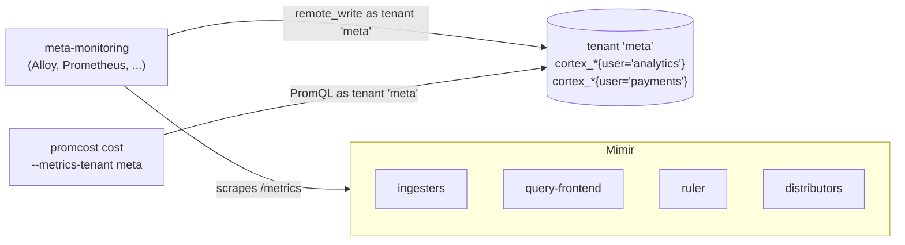

# Prerequisites

promcost needs three things:

1. a Mimir query API it can reach
2. Mimir's own metrics, scraped into one tenant of that Mimir (or of another Mimir)
3. read access as that tenant

Everything else it detects, and says what it detected: the replication factor, the write path and the rule evaluation mode.

## Supported Mimir versions

| Mimir | Status |
|---|---|
| 3.2.0 (Helm chart `mimir-distributed` 6.2.0), microservices mode | **Developed and tested against this**, on the repo's Kubernetes rig ([`dev/mimir-k8s`](../dev/mimir-k8s)), with the classic and the ingest-storage write path, and with remote rule evaluation |
| 3.2.0, monolithic (single binary) | Works for shares. Replica counts and prices are less meaningful, because every pool is the same process |
| other versions | Untested. The driver metrics are long-standing `cortex_*` metrics, but promcost hasn't checked their names or labels on other versions |

<!-- TODO(launch/validation): add the staging validation's coverage (topologies, write paths, evaluation modes) once its report is committed. -->

Reports from other versions are welcome as issues.

## Mimir's own metrics, and the metrics tenant

`--metrics-tenant` names **the tenant that holds Mimir's own `cortex_*` metrics**, the one your meta-monitoring writes into. It is **not** a tenant you want to cost. The tenants you're costing appear only as values of the `user` label inside it.

If you get this wrong, every pool is "not measured" and the run still exits 0. See [Troubleshooting](troubleshooting.md#everything-is-not-measured).

### Which metrics must be scraped

| Component | Metrics promcost reads | Needed for |
|---|---|---|
| ingesters | `cortex_ingester_active_series`, plus `cortex_partition_ring_partitions` under ingest storage | pool 1 |
| distributors | `cortex_distributor_replication_factor` | pool 1's absolute figures (not shares) under the classic write path |
| query-frontend | `cortex_query_fetched_chunk_bytes_total`, `cortex_query_samples_processed_total`, `cortex_query_fetched_series_total`, `cortex_query_seconds_total` | pool 6 |
| ruler | `cortex_prometheus_rule_evaluation_duration_seconds_sum`, `cortex_ruler_query_seconds_total` | pool 7, and detecting the evaluation mode |

The simplest rule is to scrape every Mimir pod's `/metrics`. Keep these labels:

- **`pod`**: under ingest storage, promcost collapses zone replicas using the pod name's trailing ordinal (e.g. `mimir-ingester-zone-a-0`)
- **`job`, `namespace` and `cluster`** (whichever you have): the ingest-storage guard matches on them

These are the labels the [Mimir mixin](https://github.com/grafana/mimir/tree/main/operations/mimir-mixin) expects too.

### Ways to get them there

Any scraper that remote-writes into a Mimir tenant works. These are the common setups:

- **Grafana Alloy**: scrape the Mimir pods and `prometheus.remote_write` with `headers = {"X-Scope-OrgID" = "<metrics tenant>"}`. [`dev/mimir-k8s/alloy/config.alloy`](../dev/mimir-k8s/alloy/config.alloy) is the config promcost is tested against, and it writes into the `monitoring` tenant.
- **The `mimir-distributed` Helm chart's `metaMonitoring` section**: it can create ServiceMonitors for Mimir's own components, for a Prometheus Operator to pick up. Check the `metaMonitoring` keys in your chart version's `values.yaml`. Whatever does the scraping must then remote-write into a tenant promcost can query.
- **kube-prometheus-stack** (or any Prometheus): scrape Mimir via ServiceMonitors or PodMonitors, and add a `remoteWrite` entry pointing at Mimir's `/api/v1/push`, with an `X-Scope-OrgID` header naming the metrics tenant.

The metrics tenant can live in the Mimir you're costing, or in a separate monitoring Mimir. `backend.url` points at whichever one holds it.

**One Mimir cluster per metrics tenant.** promcost's queries aren't filtered by `cluster`. If one tenant holds the metrics of several Mimir clusters, their figures are added together (#54).

## Replication factor

Shares don't depend on the replication factor, because a uniform replication factor cancels in a ratio. Absolute active series figures do. promcost resolves it in this order:

1. **Ingest storage:** none is needed. The driver query already counts each series once, and `inventory.replication_factor` is ignored, with a note saying so.
2. **`inventory.replication_factor`** in `promcost.yaml`, if set. If it differs from what Mimir reports, the report says so.
3. **`max(max_over_time(cortex_distributor_replication_factor[<window>]))`**, read from the metrics tenant.
4. **None of these:** absolute active series are shown as "withheld (no RF)", and shares are unaffected.

Pools 6 and 7 are counters recorded once per request, so no replication factor applies to them.

## Write path: classic or ingest storage

promcost detects the write path and records it as `write path` in pool 1's assumptions:

| Write path | How pool 1 counts series |
|---|---|
| **classic** (distributors push to ingesters) | Sums active series across ingesters, then divides by the replication factor. Ingesters exporting `cortex_partition_ring_partitions` are excluded. |
| **ingest storage** (Kafka; the chart's default since 6.0) | Takes the max across zone replicas of each partition, then sums across partitions. No divisor is needed. |

It tries the classic query first, and uses the ingest-storage query only if the classic one returns nothing. During a migration it picks one, as the Mimir mixin does, rather than adding both.

## Rule evaluation: local, remote or unknown

Where rule work lands depends on how the ruler evaluates rules. promcost infers this from which metrics exist:

| Mode | Evidence | Pool 6 (query path) | Pool 7 (ruler CPU) |
|---|---|---|---|
| **local** (Mimir's default) | `cortex_ruler_query_seconds_total` has data | user and API queries only | all rule evaluation time is ruler CPU |
| **remote** (`-ruler.query-frontend.address` set) | rule evaluations exist, but `cortex_ruler_query_seconds_total` has none | **includes** every tenant's rule queries, and no label separates them from user queries | mostly the ruler *waiting* on the query path. The report adds a note, and if both pools are priced, the cross-pool total notes that rule work weighs on both |
| **unknown** | neither metric has data | — | — |

"Unknown" means no tenant evaluated rules in the window, or the ruler isn't scraped. promcost doesn't guess either way. In v0.1 the mode can't be overridden in config.

**A dedicated ruler query path** (the chart's remote-evaluation option with its own ruler query-frontend and queriers) is folded into pool 6: promcost sums every query-frontend. Price those pods as part of the `query-frontend` and `querier` components if you want them in the cost.

## Permissions and headers

promcost only reads. It sends `GET` requests to:

| Endpoint | Sent as tenant | When |
|---|---|---|
| `/prometheus/api/v1/query` | the `--metrics-tenant` | always |
| `/prometheus/api/v1/query` | **each costed tenant** | `cost --rule-outputs` (counts each rule's output series) |
| `/prometheus/api/v1/rules` | each tenant in `--tenant` | `cost --rule-outputs` or `report` without `--dir` |

- **Tenant header:** `X-Scope-OrgID` by default. Change it with `tenancy.header` if a proxy in front of Mimir expects another header.
- **Auth:** a bearer token, read from the environment variable named in `backend.auth.bearer_token_env`. That's the only method in v0.1. There's no basic auth and no client TLS settings (#55). If your gateway needs basic auth, put promcost behind a local proxy that adds it, or `kubectl port-forward` to the query-frontend or gateway service.
- **Network:** promcost talks to `backend.url` and nothing else. It sends no telemetry.

## Known limitations in v0.1

- One Mimir cluster per metrics tenant (#54).
- Bearer token is the only auth method (#55).
- Pools 2 to 5 (write path, object storage, store-gateway, compactor) aren't modelled. They're listed in every report.
- One window at a time: no comparisons and no history.
